<div align="center">

# Any-Video-Production

**A code-rendered film studio you can clone.**
Research a niche → write and humanise the script → score the hook → direct in one of 100 styles → draw every frame in code → design the sound → post it.

No video model. No editing timeline. No subscription.

[](LICENSE)
[](https://nodejs.org)
[](https://python.org)
[](https://ffmpeg.org)
[](https://github.com/lemomo-ai/lemo-opuscar)
[](https://github.com/Leonxlnx/earshot)
[](https://github.com/lemomo-ai/lemo-opuscar)

[Quickstart](#quickstart) · [The five stages](#the-five-stages) · [Commands](#the-command-surface) · [Skills](#the-skills-in-this-repo) · [House rules](#house-rules) · [Troubleshooting](#troubleshooting) · [Credits](#credits)

</div>

---

## Why this exists

Most "AI video" tools rent you a model. You write a prompt, you get a clip you can't edit, in a style you can't repeat, at a resolution you didn't choose. The output is unrecognisable from the next person's, and every rerun is a new dice roll.

This repo takes the other route. A film is a **program**: HTML and Canvas rendered frame-by-frame in headless Chromium, blended and mixed, then encoded by ffmpeg. That means every frame is deterministic, every style is a reusable spec, and the only cost is your machine's time — a 15-second vertical reel renders in about 20 seconds.

Around that engine sit the four stages people actually get wrong: **what to make** (research), **what to say** (script + humanizer), **how to open** (a scored hook), and **how it sounds** (a real SFX bank with measurement). This repo wires all five together with one command each, and writes down the contracts between them.

## The five stages

| # | Stage | Backed by | Upstream | Licence |
|---|---|---|---|---|
| 1 | **Research** — what is working in your niche, ranked by outlier multiple over each account's own median | `skills/content-research`, `skills/instagram-research`, `skills/instagram`, `skills/reel-analyzer` | [Ootto-AI/claude-content-skills](https://github.com/Ootto-AI/claude-content-skills) · [proyecto26/instagram-ai-plugin](https://github.com/proyecto26/instagram-ai-plugin) | MIT |
| 2 | **Scripting** — a story to one person, then the AI tells stripped out | `skills/humanizer` + the engine's `DIRECTOR.md` | [blader/humanizer](https://github.com/blader/humanizer) · [lemomo-ai/lemo-opuscar](https://github.com/lemomo-ai/lemo-opuscar) | MIT |
| 3 | **Hook** — three candidates from three formulas, scored on five axes | `skills/instagram-content/scripts/` + `bin/hook.sh` | [proyecto26/instagram-ai-plugin](https://github.com/proyecto26/instagram-ai-plugin) (26 formulas, `hook-score.ts`) | MIT |
| 4 | **Video** — treatment, style, code, frames | `skills/lemo-opuscar` + `bin/render.sh` | [lemomo-ai/lemo-opuscar](https://github.com/lemomo-ai/lemo-opuscar) — **100 styles** | MIT AND CC-BY-NC-4.0 |
| 5 | **SFX** — one sound per visible action, measured, mixed | `skills/earshot` + `bin/sfx.sh` | [Leonxlnx/earshot](https://github.com/Leonxlnx/earshot) — **252 sounds** | MIT |

Two of those stages are judgement, not code: **picking the idea** (score multiple · repeatability · fit) and **checking the source** (primary page, quoted verbatim). The pipeline says how; no tool pretends to do it for you.

<div align="center">
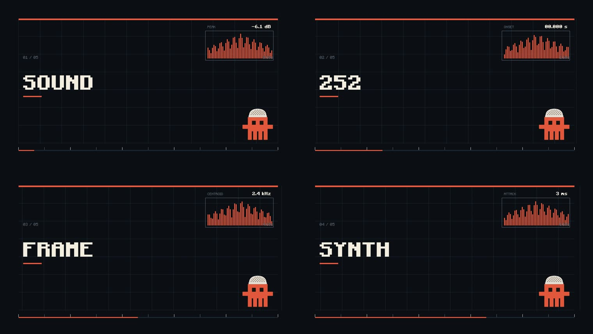
<br><sub>Four of the five beats from <code>films/sound-test</code> — the 10-second film whose sound was designed with earshot.</sub>
</div>

## Quickstart

```bash
git clone git@github.com:radixx-dev/Any-Video-Production.git
cd Any-Video-Production
./install.sh                    # same as ./setup.sh: checks tools, fetches the heavy parts
./setup.sh --check              # report only, installs nothing
```

Then, before you spend a minute on a film, prove each stage answers:

```bash
./bin/hook.sh --hook "Two words. Heavy on the scale."   # scores a hook
./bin/render.sh still templates/film 0.5 1.5            # two real frames, ~70 ms each
./bin/sfx.sh sfx list | head                            # the SFX bank
./bin/research.sh status                                # Instagram session, redacted
```

Point an agent at the folder and say *"make a film about X in Y style"*: it reads `skills/pipeline/SKILL.md` (the order of work) and `AGENTS.md` (the house rules), and drives the wrappers.

## How a film is made

```
topic / niche
    │
    ├─ 1  research ......... swipe file of outliers, formulas, comments       → swipe.md
    ├─ 2  idea ............  multiple · repeatability · fit                  → ## Idea
    ├─ 3  script ..........  one idea per screen, one citation per screen    → script draft
    ├─ 4  humanize ........  no AI tells, facts untouched                    → final script
    ├─ 5  hook ............  three formulas, five scores, weakest axis fixed → ## Hooks
    ├─ 6  source ..........  primary page, quoted verbatim                   → ## Sources
    ├─ 7  style ...........  STYLE.md invariants + treatment                 → TREATMENT.md
    ├─ 8  build ...........  window.render(t), pure function of time         → index.html
    ├─ 9  render ..........  readcheck → events → video.mjs → mux.sh         → film.mp4
    ├─ 10 voice ...........  Kokoro offline / edge-tts + ASR check            → out/*.wav
    ├─ 11 sound ...........  earshot SFX, measured, mixed to −14 LUFS        → mix.wav
    └─ 12 post ............  caption linted, dry run, confirm, 48 h numbers  → live
```

Every stage writes a file the next stage reads. Nothing skips its check, and nothing is "done" because it looked fine in a still.

## Repository map

```text
Any-Video-Production/
├── README.md                  this file
├── AGENTS.md                  the rules an agent must follow (craft + house style)
├── CREDITS.md                 every third-party component and its licence
├── LICENSE                    MIT (your code and docs)
├── setup.sh                   toolchain check · Lemo library · optional earshot env
│
├── bin/                       one command per stage
│   ├── research.sh            Instagram: status · login · swipe · posts · media · comments
│   ├── hook.sh                the 26-formula scorer
│   ├── render.sh              Lemo tools: still · video · events · readcheck · mux · sheet
│   └── sfx.sh                 earshot: sfx list · sfx render · measure · timeline
│
├── skills/
│   ├── pipeline/SKILL.md      the 12 stages, each with its command and contract
│   ├── instagram-research/    outlier research through your own browser session
│   ├── instagram/             the client: login, swipe, media, comments, post (dry run)
│   ├── instagram-content/     26 hook formulas, hook-score, caption-lint, beats, slop
│   ├── content-research/      a creator → outliers → playbook
│   ├── reel-analyzer/         frame-by-frame teardown of one winning reel
│   ├── humanizer/             strips the AI fingerprint from prose
│   ├── lemo-opuscar/          the engine's fetcher and hand-over
│   └── earshot/               how to judge, choose and verify sound
│
├── templates/film/            an empty film: page contract, build.sh, TREATMENT.md
├── docs/chain.md              stage → command → artefact, as a table
├── films/sound-test/          a working 10 s film: page, mix builder, finished MP4
└── styles/README.md           choosing a style · external style libraries
```

**63 files, ~600 KB**, because the heavy parts are fetched, not committed.

## The command surface

### `bin/research.sh` — what is working

```bash
./bin/research.sh status                       # who is signed in (redacted lengths only)
./bin/research.sh login                        # opens Chrome, sign in, 2FA is fine
./bin/research.sh swipe a,b,c --limit 24 --min 3 --json > swipe.json
./bin/research.sh posts <username> --limit 30
./bin/research.sh media <url|shortcode>
./bin/research.sh comments <url> --limit 20
./bin/research.sh hashtag <tag> --limit 24
./bin/research.sh search "<query>"
./bin/research.sh post <media> --caption "…"                 # dry run: prints, sends nothing
./bin/research.sh post <media> --caption "…" --confirm --account <user>
```

Limits the CLI enforces: **12 accounts, 50 posts each, ≥1.5 s apart, read-only.** On `rate_limited`, `checkpoint` or `not_logged_in` it stops and reports the hint instead of retrying. No Apify, no API keys — your own session, your own account.

### `bin/hook.sh` — the opening line

```bash
./bin/hook.sh --hook "Proposals used to take me five hours"
./bin/hook.sh --hook "candidate" --json
```

Scores **length, specificity, stakes, frontload**, plus spoken time. The report names the weakest axis, so you fix that instead of rewriting blind.

### `bin/render.sh` — every frame

```bash
./bin/render.sh still     films/my-film 1.5 3 5                 # review JPEGs
./bin/render.sh readcheck films/my-film                          # is text held long enough?
./bin/render.sh events    films/my-film                          # cue map → events.json
./bin/render.sh video     films/my-film --fps 30 --workers 4     # frames → video
./bin/render.sh mux       films/my-film/out/video.mp4 \
                          films/my-film/mix.wav \
                          films/my-film/my-film.mp4 30 2         # master to −14 LUFS
./bin/render.sh sheet     contact.jpg films/my-film/stills/*.jpg
```

### `bin/sfx.sh` — sound you can measure

```bash
./bin/sfx.sh sfx list                          # 252 sounds: id, duration, peak, pitch
./bin/sfx.sh sfx render cut_hit/punch -o punch.wav
./bin/sfx.sh measure films/my-film/my-film.mp4
./bin/sfx.sh timeline films/my-film/my-film.mp4 -o cues.json
```

## The skills in this repo

| Skill | What it does | Upstream |
|---|---|---|
| `pipeline` | the 12 stages, contracts, overrides | this repo |
| `instagram-research` | outliers by multiple over own median; hook classification; swipe file | [proyecto26/instagram-ai-plugin](https://github.com/proyecto26/instagram-ai-plugin) |
| `instagram` | session client: read everything, publish with approval | same |
| `instagram-content` | 26 hook formulas, scorer, caption linter, beat builder | same |
| `content-research` | creator → outlier map → format playbook | [Ootto-AI/claude-content-skills](https://github.com/Ootto-AI/claude-content-skills) |
| `reel-analyzer` | frame-by-frame teardown of one reel | same |
| `humanizer` | removes AI tells without changing meaning | [blader/humanizer](https://github.com/blader/humanizer) |
| `lemo-opuscar` | fetches the engine library, then follows its `AGENTS.md` | [lemomo-ai/lemo-opuscar](https://github.com/lemomo-ai/lemo-opuscar) |
| `earshot` | listening, choosing, measuring and verifying sound | [Leonxlnx/earshot](https://github.com/Leonxlnx/earshot) |

## The gallery: all 100 styles

One card per style, in the library's own categories. Each card uses that style's palette and grammar, read straight out of its `STYLE.md` — these are **spec cards, not demo frames**: only two styles in the library ship a runnable demo (`halftone-dossier`, `paper-lantern`). Open `styles/<slug>/STYLE.md` in the library for the invariants; regenerate the set with `./tools/card/render.sh`.

### Edit &amp; Documentary · 8

<table>
<tr><td align="center" width="20%">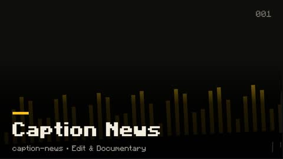<br><sub><b>Caption News</b><br><code>caption-news</code></sub></td><td align="center" width="20%">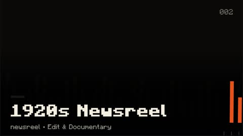<br><sub><b>1920s Newsreel</b><br><code>newsreel</code></sub></td><td align="center" width="20%">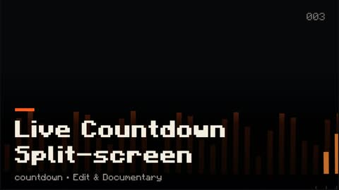<br><sub><b>Live Countdown Split-screen</b><br><code>countdown</code></sub></td><td align="center" width="20%">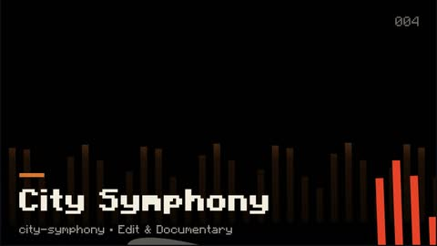<br><sub><b>City Symphony</b><br><code>city-symphony</code></sub></td><td align="center" width="20%">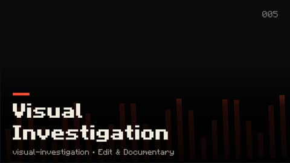<br><sub><b>Visual Investigation</b><br><code>visual-investigation</code></sub></td></tr>
<tr><td align="center" width="20%">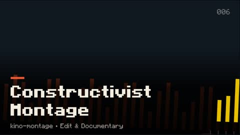<br><sub><b>Constructivist Montage</b><br><code>kino-montage</code></sub></td><td align="center" width="20%">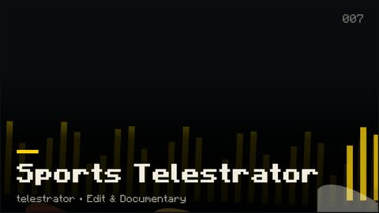<br><sub><b>Sports Telestrator</b><br><code>telestrator</code></sub></td><td align="center" width="20%">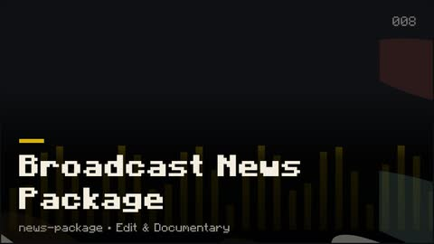<br><sub><b>Broadcast News Package</b><br><code>news-package</code></sub></td></tr>
</table>

### Painting &amp; Illustration · 5

<table>
<tr><td align="center" width="20%">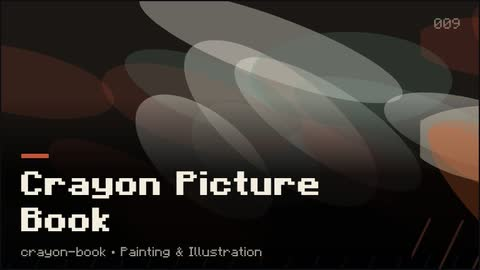<br><sub><b>Crayon Picture Book</b><br><code>crayon-book</code></sub></td><td align="center" width="20%">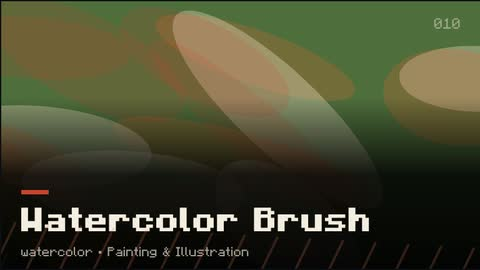<br><sub><b>Watercolor Brush</b><br><code>watercolor</code></sub></td><td align="center" width="20%">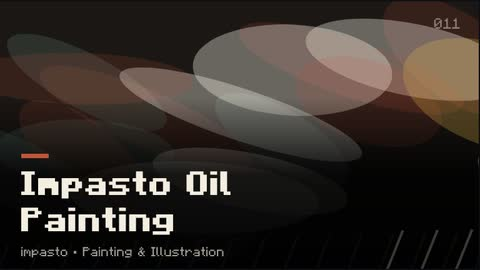<br><sub><b>Impasto Oil Painting</b><br><code>impasto</code></sub></td><td align="center" width="20%">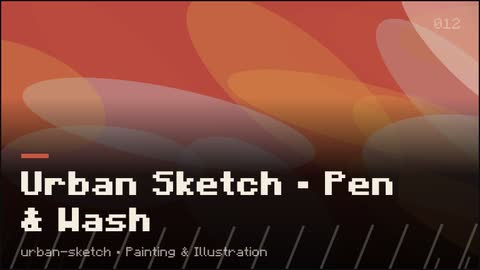<br><sub><b>Urban Sketch · Pen &amp; Wash</b><br><code>urban-sketch</code></sub></td><td align="center" width="20%">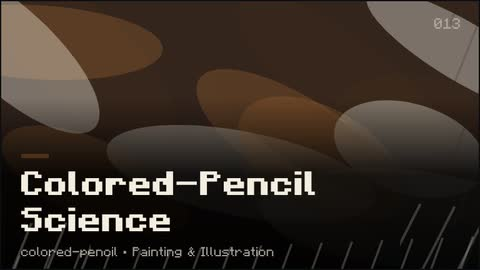<br><sub><b>Colored-Pencil Science Illustration</b><br><code>colored-pencil</code></sub></td></tr>
</table>

### Sketch &amp; Board · 7

<table>
<tr><td align="center" width="20%">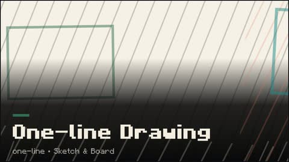<br><sub><b>One-line Drawing</b><br><code>one-line</code></sub></td><td align="center" width="20%">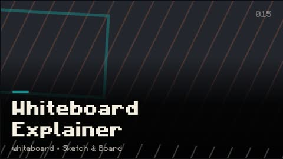<br><sub><b>Whiteboard Explainer</b><br><code>whiteboard</code></sub></td><td align="center" width="20%">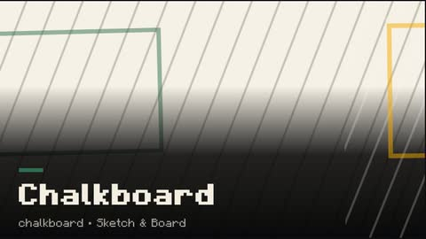<br><sub><b>Chalkboard</b><br><code>chalkboard</code></sub></td><td align="center" width="20%">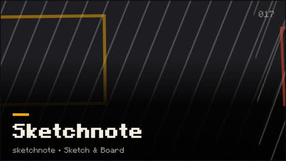<br><sub><b>Sketchnote</b><br><code>sketchnote</code></sub></td><td align="center" width="20%">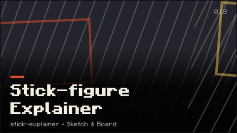<br><sub><b>Stick-figure Explainer</b><br><code>stick-explainer</code></sub></td></tr>
<tr><td align="center" width="20%">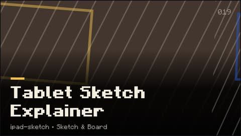<br><sub><b>Tablet Sketch Explainer</b><br><code>ipad-sketch</code></sub></td><td align="center" width="20%">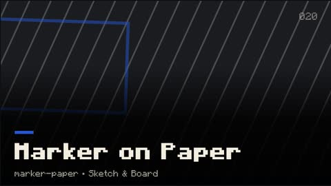<br><sub><b>Marker on Paper</b><br><code>marker-paper</code></sub></td></tr>
</table>

### Traditional Crafts · 7

<table>
<tr><td align="center" width="20%"><br><sub><b>Chinese Ink Wash</b><br><code>ink-wash</code></sub></td><td align="center" width="20%">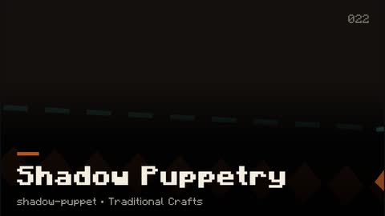<br><sub><b>Shadow Puppetry</b><br><code>shadow-puppet</code></sub></td><td align="center" width="20%"><br><sub><b>Ukiyo-e</b><br><code>ukiyoe</code></sub></td><td align="center" width="20%">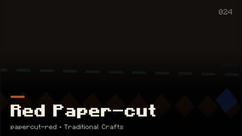<br><sub><b>Red Paper-cut</b><br><code>papercut-red</code></sub></td><td align="center" width="20%">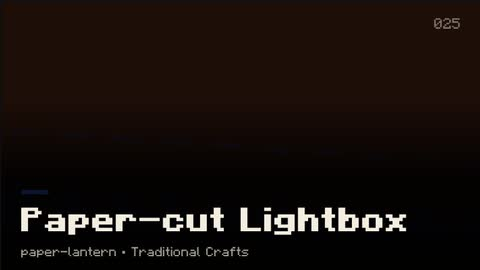<br><sub><b>Paper-cut Lightbox</b><br><code>paper-lantern</code></sub></td></tr>
<tr><td align="center" width="20%">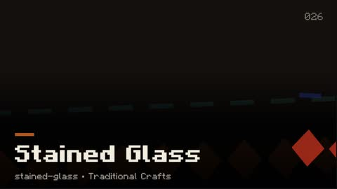<br><sub><b>Stained Glass</b><br><code>stained-glass</code></sub></td><td align="center" width="20%"><br><sub><b>Gilded Illumination</b><br><code>gilded-illumination</code></sub></td></tr>
</table>

### Print &amp; Printmaking · 8

<table>
<tr><td align="center" width="20%">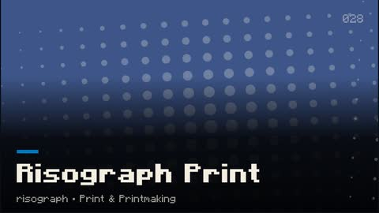<br><sub><b>Risograph Print</b><br><code>risograph</code></sub></td><td align="center" width="20%">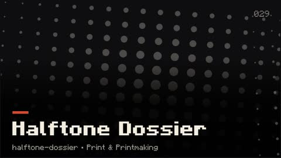<br><sub><b>Halftone Dossier</b><br><code>halftone-dossier</code></sub></td><td align="center" width="20%">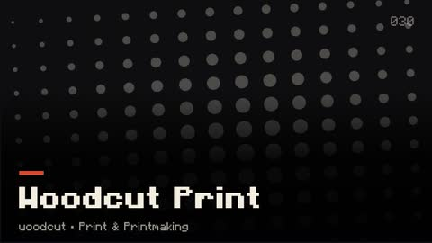<br><sub><b>Woodcut Print</b><br><code>woodcut</code></sub></td><td align="center" width="20%">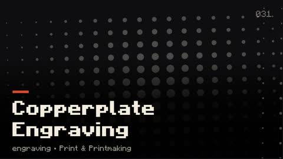<br><sub><b>Copperplate Engraving</b><br><code>engraving</code></sub></td><td align="center" width="20%">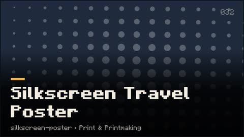<br><sub><b>Silkscreen Travel Poster</b><br><code>silkscreen-poster</code></sub></td></tr>
<tr><td align="center" width="20%">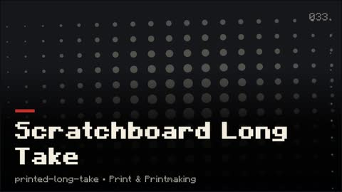<br><sub><b>Scratchboard Long Take</b><br><code>printed-long-take</code></sub></td><td align="center" width="20%">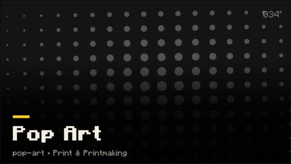<br><sub><b>Pop Art</b><br><code>pop-art</code></sub></td><td align="center" width="20%"><br><sub><b>Vintage Engraving Collage</b><br><code>vintage-collage</code></sub></td></tr>
</table>

### Graphic &amp; Type · 9

<table>
<tr><td align="center" width="20%">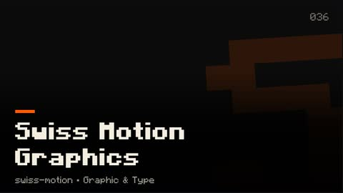<br><sub><b>Swiss Motion Graphics</b><br><code>swiss-motion</code></sub></td><td align="center" width="20%">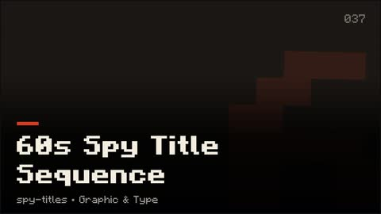<br><sub><b>60s Spy Title Sequence</b><br><code>spy-titles</code></sub></td><td align="center" width="20%">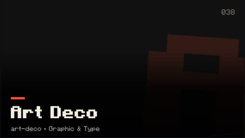<br><sub><b>Art Deco</b><br><code>art-deco</code></sub></td><td align="center" width="20%">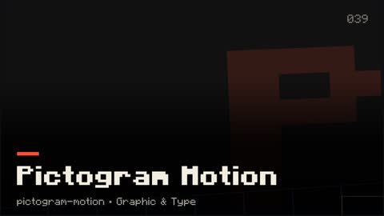<br><sub><b>Pictogram Motion</b><br><code>pictogram-motion</code></sub></td><td align="center" width="20%">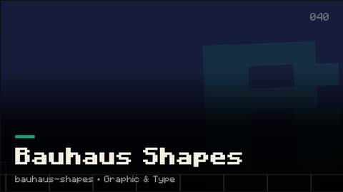<br><sub><b>Bauhaus Shapes</b><br><code>bauhaus-shapes</code></sub></td></tr>
<tr><td align="center" width="20%">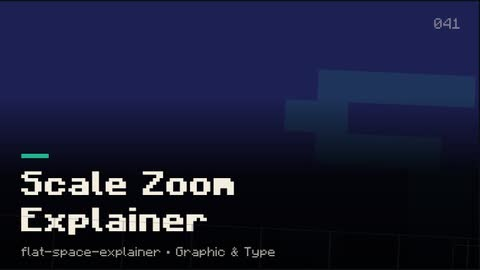<br><sub><b>Scale Zoom Explainer</b><br><code>flat-space-explainer</code></sub></td><td align="center" width="20%">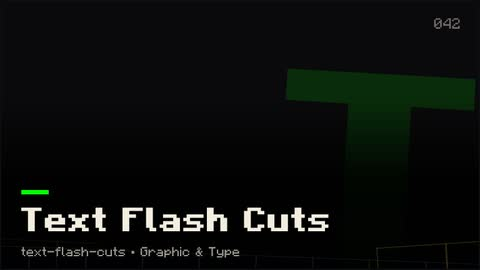<br><sub><b>Text Flash Cuts</b><br><code>text-flash-cuts</code></sub></td><td align="center" width="20%">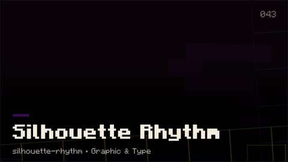<br><sub><b>Silhouette Rhythm</b><br><code>silhouette-rhythm</code></sub></td><td align="center" width="20%">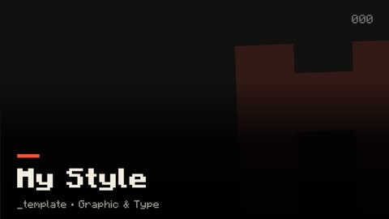<br><sub><b>My Style</b><br><code>_template</code></sub></td></tr>
</table>

### Line Diagrams · 8

<table>
<tr><td align="center" width="20%">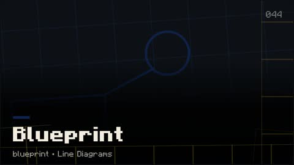<br><sub><b>Blueprint</b><br><code>blueprint</code></sub></td><td align="center" width="20%">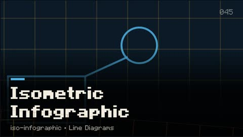<br><sub><b>Isometric Infographic</b><br><code>iso-infographic</code></sub></td><td align="center" width="20%">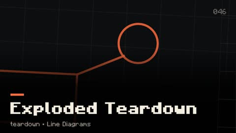<br><sub><b>Exploded Teardown</b><br><code>teardown</code></sub></td><td align="center" width="20%">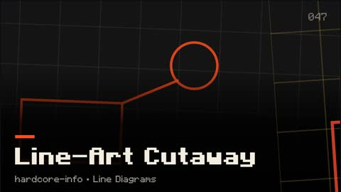<br><sub><b>Line-Art Cutaway</b><br><code>hardcore-info</code></sub></td><td align="center" width="20%">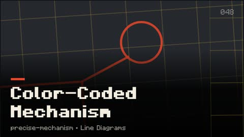<br><sub><b>Color-Coded Mechanism</b><br><code>precise-mechanism</code></sub></td></tr>
<tr><td align="center" width="20%">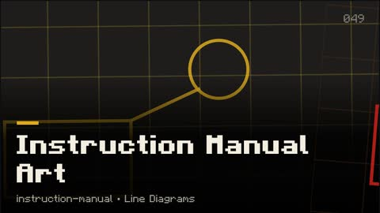<br><sub><b>Instruction Manual Art</b><br><code>instruction-manual</code></sub></td><td align="center" width="20%">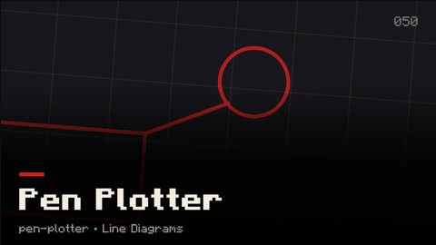<br><sub><b>Pen Plotter</b><br><code>pen-plotter</code></sub></td><td align="center" width="20%">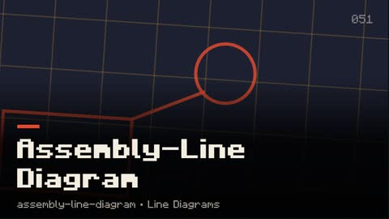<br><sub><b>Assembly-Line Diagram</b><br><code>assembly-line-diagram</code></sub></td></tr>
</table>

### Cartoons · 6

<table>
<tr><td align="center" width="20%">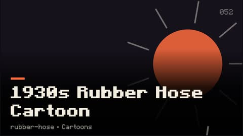<br><sub><b>1930s Rubber Hose Cartoon</b><br><code>rubber-hose</code></sub></td><td align="center" width="20%"><br><sub><b>80s Cel Anime</b><br><code>cel-anime-80s</code></sub></td><td align="center" width="20%"><br><sub><b>Sci-Fi Sitcom Toon</b><br><code>scifi-toon</code></sub></td><td align="center" width="20%"><br><sub><b>Mid-century Cartoon</b><br><code>midcentury-toon</code></sub></td><td align="center" width="20%"><br><sub><b>Comic History Cartoon</b><br><code>comic-history</code></sub></td></tr>
<tr><td align="center" width="20%"><br><sub><b>Manga Panels</b><br><code>manga-panels</code></sub></td></tr>
</table>

### Games · 4

<table>
<tr><td align="center" width="20%"><br><sub><b>16-bit Pixel RPG</b><br><code>pixel-rpg</code></sub></td><td align="center" width="20%"><br><sub><b>2.5D Pixel Art</b><br><code>hd-2d</code></sub></td><td align="center" width="20%"><br><sub><b>Microgame Frenzy</b><br><code>microgame</code></sub></td><td align="center" width="20%"><br><sub><b>Rhythm Game Show</b><br><code>game-show</code></sub></td></tr>
</table>

### Film &amp; Tape · 5

<table>
<tr><td align="center" width="20%"><br><sub><b>CRT ASCII Terminal</b><br><code>ascii-crt</code></sub></td><td align="center" width="20%"><br><sub><b>1920s Silent Film</b><br><code>silent-film</code></sub></td><td align="center" width="20%"><br><sub><b>Liminal Found Footage</b><br><code>backrooms</code></sub></td><td align="center" width="20%"><br><sub><b>Scratch Film</b><br><code>scratch-film</code></sub></td><td align="center" width="20%"><br><sub><b>Double Exposure</b><br><code>double-exposure</code></sub></td></tr>
</table>

### Screens &amp; Interfaces · 6

<table>
<tr><td align="center" width="20%"><br><sub><b>Dark Tech Keynote</b><br><code>dark-keynote</code></sub></td><td align="center" width="20%"><br><sub><b>Mascot Screencast</b><br><code>living-screencast</code></sub></td><td align="center" width="20%"><br><sub><b>Sci-fi Hologram HUD</b><br><code>hologram-hud</code></sub></td><td align="center" width="20%"><br><sub><b>Tabletop App Flythrough</b><br><code>desktop-flythrough</code></sub></td><td align="center" width="20%"><br><sub><b>Spreadsheet Film</b><br><code>spreadsheet</code></sub></td></tr>
<tr><td align="center" width="20%"><br><sub><b>1-bit Dither</b><br><code>one-bit-dither</code></sub></td></tr>
</table>

### Light &amp; Lines · 5

<table>
<tr><td align="center" width="20%"><br><sub><b>Circuit Board</b><br><code>circuit-board</code></sub></td><td align="center" width="20%"><br><sub><b>Firefly Pointillism</b><br><code>firefly-pointillism</code></sub></td><td align="center" width="20%"><br><sub><b>Flow-field Wind Lines</b><br><code>flow-field</code></sub></td><td align="center" width="20%"><br><sub><b>Oscilloscope Math</b><br><code>oscilloscope-math</code></sub></td><td align="center" width="20%"><br><sub><b>Neon Tubes</b><br><code>neon-tubes</code></sub></td></tr>
</table>

### 3D &amp; Miniature · 8

<table>
<tr><td align="center" width="20%"><br><sub><b>Brick Toy</b><br><code>brick-toy</code></sub></td><td align="center" width="20%"><br><sub><b>Paper Pop-up Book</b><br><code>paper-popup</code></sub></td><td align="center" width="20%"><br><sub><b>Tilt-Shift Miniature</b><br><code>tilt-shift</code></sub></td><td align="center" width="20%"><br><sub><b>Low-poly Isometric Island</b><br><code>lowpoly-island</code></sub></td><td align="center" width="20%"><br><sub><b>Glass Product Render</b><br><code>glass-product</code></sub></td></tr>
<tr><td align="center" width="20%"><br><sub><b>Memphis Diorama</b><br><code>memphis-diorama</code></sub></td><td align="center" width="20%"><br><sub><b>Isometric People Scene</b><br><code>isometric-picture-book</code></sub></td><td align="center" width="20%"><br><sub><b>Crayon World 3D</b><br><code>crayon-world</code></sub></td></tr>
</table>

### Instruments &amp; Evidence · 8

<table>
<tr><td align="center" width="20%"><br><sub><b>Satellite Briefing</b><br><code>satellite-briefing</code></sub></td><td align="center" width="20%"><br><sub><b>Engineering Briefing Board</b><br><code>briefing-board</code></sub></td><td align="center" width="20%"><br><sub><b>LiDAR Survey</b><br><code>lidar-survey</code></sub></td><td align="center" width="20%"><br><sub><b>Under the Microscope</b><br><code>microscope</code></sub></td><td align="center" width="20%"><br><sub><b>Archive Light Table</b><br><code>archive-lighttable</code></sub></td></tr>
<tr><td align="center" width="20%"><br><sub><b>Security X-ray</b><br><code>security-xray</code></sub></td><td align="center" width="20%"><br><sub><b>Radar Sweep Documentary</b><br><code>dark-documentary</code></sub></td><td align="center" width="20%"><br><sub><b>Thermal Camera</b><br><code>thermal-camera</code></sub></td></tr>
</table>

### Data &amp; Maps · 6

<table>
<tr><td align="center" width="20%"><br><sub><b>Data Storytelling</b><br><code>dataviz</code></sub></td><td align="center" width="20%"><br><sub><b>Projection-Mapped Model</b><br><code>white-model</code></sub></td><td align="center" width="20%"><br><sub><b>Data Physicalization</b><br><code>data-physical</code></sub></td><td align="center" width="20%"><br><sub><b>Transit Map</b><br><code>transit-map</code></sub></td><td align="center" width="20%"><br><sub><b>3D Map Explainer</b><br><code>map-explainer</code></sub></td></tr>
<tr><td align="center" width="20%"><br><sub><b>Blob Simulation</b><br><code>pip-simulation</code></sub></td></tr>
</table>

## Sound

earshot is the sound engine: a **252-sound procedural bank** plus the tools to judge it —
`describe`, `match`, `rank`, `find`, `compare`, `ab`, `timeline`, `measure`. The rules this repo
enforces around it:

- one sound per visible action, matched to the material — paper, wood, metal, ink and glass differ
- peaks within ~8 dB of the voice peak, placed one frame after the picture move
- **no music**: voice and foley only
- mastered to −14 LUFS / ≤ −1 dBTP, and the measured number is what gets reported

[`films/sound-test/`](films/sound-test/README.md) is a working example: 300 frames at 30 fps, five
structural beats, seven bank cues. Measured sub band −14.8 dB, brightness 3492 Hz, attack 38 ms,
mastered to −15.4 LUFS at −1.4 dBTP. Watch it here: [`sound-test.mp4`](films/sound-test/sound-test.mp4).

## Requirements

| Tool | Version | Why |
|---|---|---|
| Node | ≥ 20 (22 recommended) | the renderer, and `npx bun` for the hook scorer |
| Python | ≥ 3.11 | earshot, subtitles, contact sheets |
| FFmpeg | ≥ 7 | encoding and mastering |
| git | any | fetching the engine |

`./setup.sh` and `./install.sh` are the same script — pick whichever name you expect.
| uv | optional | faster venvs |

What `./setup.sh` downloads on first run, so nobody mistakes it for a bug:

- the **Lemo library** (~150 MB sparse clone: guides, `core/` tools, every `STYLE.md`) into `~/lemo-opuscar`
- **Playwright's Chromium headless shell** for frame capture
- with `--with-sfx`: **earshot** into `vendor/earshot/.venv`, pinned to upstream commit `591fa3e0` (pulls torch — a few GB, several minutes)
- with `--with-voice`: the TTS models for narration

## Troubleshooting

| Symptom | Cause | Fix |
|---|---|---|
| `BEWARE: your OS is not officially supported by Playwright` | Linux distro without an official build | harmless — it downloads the closest fallback and renders |
| `! packages not installed yet: run 'sh setup.sh deps'` | first run, or the engine's `package.json` changed upstream | `./setup.sh`, or `sh skills/lemo-opuscar/scripts/setup.sh deps` |
| `need bun or npx` | Node < 20 or not installed | install Node 20+, `nvm use 22` |
| earshot "not installed yet" | env not built | `./setup.sh --with-sfx`, or `EARSHOT_BIN=/path/to/earshot` |
| `not_logged_in` / `checkpoint` | Instagram session expired or challenged | `./bin/research.sh login --force`, complete it in the browser |
| `no index.html in …` | pointed at a folder without a page | start from `templates/film` |
| A `✦` style refuses to start | no image generator configured | `python3 core/image/gen_image.py --check`, or pick another style |
| Readcheck fails a line | text is on screen too briefly | a line needs `0.5 s + 0.3 s × words`; cut words or hold longer |

## Verified, not claimed

These numbers come from running the repo, and they are the only performance figures stated here:

- `./setup.sh --check` → **8/8** tool checks pass
- `./bin/render.sh still` → a 1920×1080 frame in **~66–71 ms**
- `./bin/render.sh video` → 60 frames at 30 fps in **3 s**; a 459-frame 15 s reel in **~22 s**
- `./bin/render.sh readcheck` → passes when text is held long enough, and names the line that isn't
- `./bin/render.sh mux` → **−13.9 LUFS**, AAC 48 kHz stereo, 1920×1080 @ 30 fps out
- `./bin/sfx.sh sfx list` → **252 sounds**
- a fresh `git clone` of this repo, then setup + hook + still + readcheck → all pass

Not verified here, and worth knowing: a full film with narration and a mixed soundtrack has not been produced end to end in this repo yet, and an actual Instagram pull needs your own login.

## Credits

Full detail in [`CREDITS.md`](CREDITS.md).

- **[Lemo-Opuscar](https://github.com/lemomo-ai/lemo-opuscar)** — Lemomo. The engine, 100 styles, director and technique guides. `MIT AND CC-BY-NC-4.0`: the styles are **non-commercial**, which this free repo respects. Only the MIT fetcher is bundled; the library is downloaded, never committed.
- **[earshot](https://github.com/Leonxlnx/earshot)** — Leon Lin. SFX bank and sound judgement. MIT.
- **[humanizer](https://github.com/blader/humanizer)** — Siqi Chen. MIT.
- **[instagram-ai-plugin](https://github.com/proyecto26/instagram-ai-plugin)** — Proyecto 26. Research client, 26 hook formulas, caption linter. MIT.
- **[claude-content-skills](https://github.com/Ootto-AI/claude-content-skills)** — Ootto-AI. Creator research and reel teardown. MIT.
- **[ClaudeAnimationBase](https://github.com/JohnHeibel/ClaudeAnimationBase)** — John Heibel. Optional character animation: Clawd's 31 emotions, p5.brush renderer. MIT, cloned separately, not bundled.

## Roadmap

- [ ] a shipped example film, with stills in this README
- [ ] a script-writing skill so stage 2 is a tool, not only judgement
- [ ] caption and Threads variants generated from the film's own script
- [ ] preview all five beats of a style, not just one card, before committing to it

## Contributing

Issues and PRs welcome. If you add a skill, keep its `SKILL.md`, keep its licence notice, add it to `CREDITS.md`, and make sure `./setup.sh --check` still passes on a clean clone. Don't commit media, renders, envs or a copy of the engine library.

<div align="center">

If this saves you a subscription and a weekend, a ⭐ helps someone else find it.

**[⬆ back to top](#any-video-production)**

</div>
